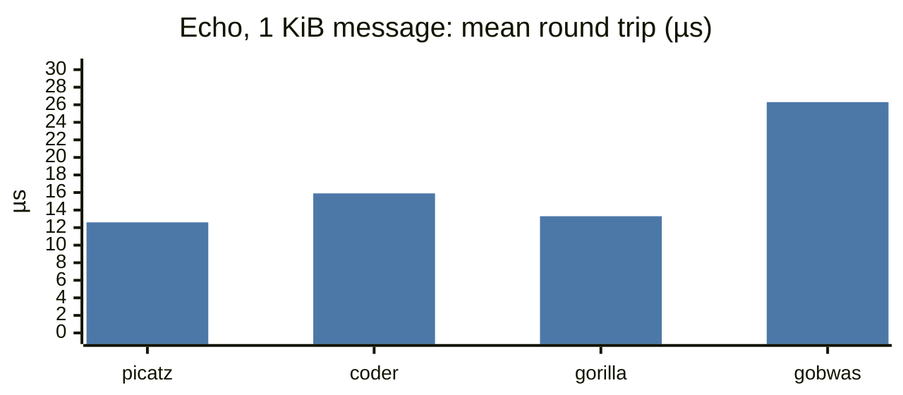
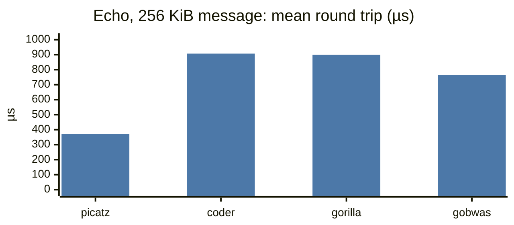
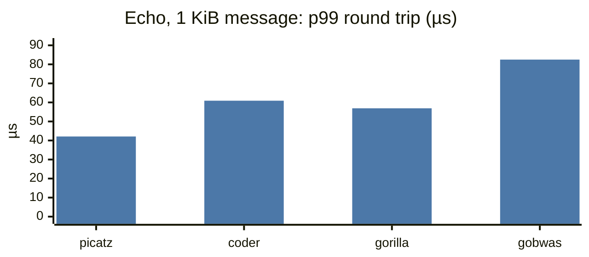
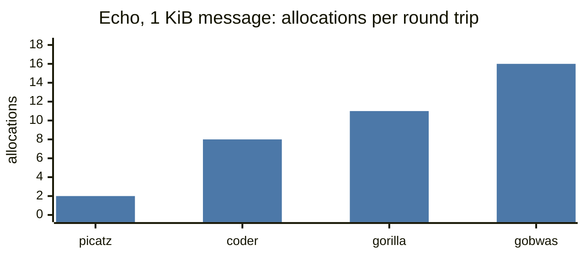
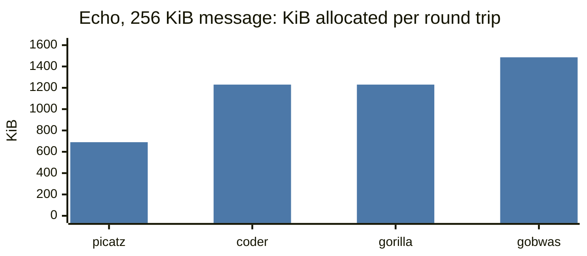
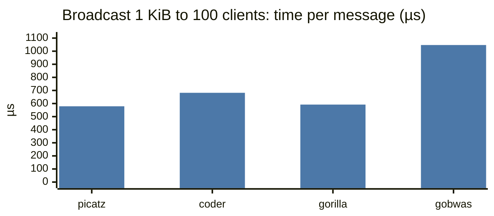
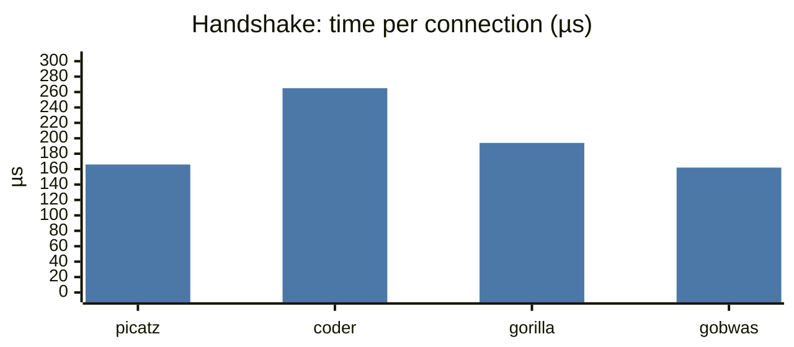
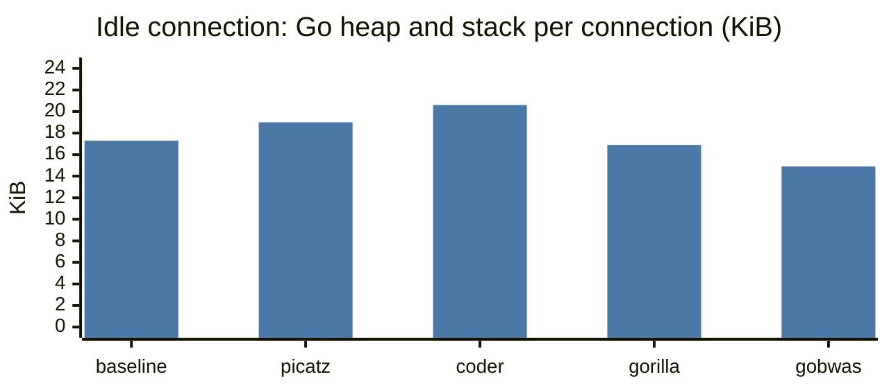

# Performance measurements

How this package compares with [`coder/websocket`], [`gorilla/websocket`] and
[`gobwas/ws`] on the same workloads, followed by how the numbers were taken and
the package's own microbenchmarks. These are indicative numbers from a shared
cloud VM, not a claim of production capacity; rerun them on your own hardware
before drawing conclusions.

## Comparison with other libraries

Medians of 10 interleaved rounds at
[`658bf72`](https://github.com/picatz/websocket/commit/658bf727a0c0fe795f245b51de151ae93d349eae)
on a shared 4-vCPU cloud VM (Intel Xeon @ 2.10GHz, linux/amd64, Go 1.27.2,
coder v1.8.15, gorilla v1.5.3, gobwas v1.4.0), taken on 2026-10-17. Raw output
is in [`benchmarks/results`](benchmarks/results/2026-10-17-linux-amd64-658bf72.txt).
Time differences under roughly 15% are within this machine's noise; allocation
counts are deterministic.

- **Echo:** fastest at 16 KiB and 256 KiB, where it is 2.1 to 2.5 times faster
  than the others. At 16 B and 1 KiB, gorilla is within noise.
- **Tail latency:** the lowest p99 round trip at every size.
- **Allocations:** one per message on each endpoint, so a small echo costs 2,
  against 2 to 16 for the others, and roughly half the bytes.
- **Broadcast:** on par with gorilla, ahead of coder and gobwas.
- **Handshake:** on par with gobwas, which allocates slightly less; ahead of
  coder and gorilla.
- **Idle memory:** the one gap. An idle connection holds about 1.8 KiB more
  than a bare hijacked net/http connection, while gorilla and gobwas come in
  under it.

### Echo round trip

One client write and one echoed read over loopback TCP, with this library on
both ends. Lower is better.







### Allocations

Heap allocations and bytes per echo round trip, counting both endpoints. Lower
is better.





### Broadcast, handshake and idle memory







The baseline is a bare hijacked net/http connection blocked in a read, with
net/http's buffers kept.

### Full results

Echo round trip, mean time per op (lower is better):

| Message | picatz | coder | gorilla | gobwas |
| ---: | ---: | ---: | ---: | ---: |
| 16 B | 10.0 µs | 12.2 µs | 10.5 µs | 21.4 µs |
| 1 KiB | 12.6 µs | 15.9 µs | 13.3 µs | 26.3 µs |
| 16 KiB | 39.9 µs | 85.8 µs | 67.5 µs | 76.7 µs |
| 256 KiB | 370 µs | 907 µs | 899 µs | 764 µs |

Echo round trip, 99th percentile (lower is better):

| Message | picatz | coder | gorilla | gobwas |
| ---: | ---: | ---: | ---: | ---: |
| 16 B | 26.3 µs | 38.0 µs | 32.1 µs | 57.2 µs |
| 1 KiB | 42.1 µs | 60.9 µs | 56.9 µs | 82.5 µs |
| 16 KiB | 226 µs | 382 µs | 353 µs | 377 µs |
| 256 KiB | 1015 µs | 2158 µs | 2155 µs | 2157 µs |

Echo round trip, allocations and bytes per op, both endpoints:

| Message | picatz | coder | gorilla | gobwas |
| ---: | ---: | ---: | ---: | ---: |
| 16 B | 2 / 32 B | 2 / 1.0 KiB | 5 / 1.1 KiB | 11 / 1.5 KiB |
| 1 KiB | 2 / 2.0 KiB | 8 / 4.3 KiB | 11 / 4.3 KiB | 16 / 4.7 KiB |
| 16 KiB | 4 / 41 KiB | 26 / 74 KiB | 31 / 74 KiB | 34 / 75 KiB |
| 256 KiB | 10 / 0.67 MiB | 40 / 1.20 MiB | 45 / 1.20 MiB | 49 / 1.45 MiB |

Parallel echo, broadcast, handshake and idle memory:

| Workload | picatz | coder | gorilla | gobwas |
| --- | ---: | ---: | ---: | ---: |
| `EchoParallel` time/op | 8.3 µs | 9.8 µs | 8.9 µs | 13.5 µs |
| `Broadcast` time/op | 579 µs | 682 µs | 592 µs | 1047 µs |
| `Broadcast` allocs/op | 100 | 400 | 500 | 700 |
| `Handshake` time/op | 166 µs | 265 µs | 194 µs | 162 µs |
| `Handshake` allocs/op | 90 | 231 | 131 | 87 |
| `Handshake` bytes/op | 18.1 KiB | 31.6 KiB | 29.6 KiB | 12.8 KiB |
| `IdleConn` bytes/conn | 19.0 KiB | 20.6 KiB | 16.9 KiB | 14.9 KiB |

The baseline for `IdleConn` was 17.3 KiB per connection.

## How the comparison works

The [`benchmarks`](benchmarks) directory is a separate Go module that runs the
same workloads against this package, [`coder/websocket`], [`gorilla/websocket`]
and [`gobwas/ws`]. It is separate so the core module keeps no third-party
dependencies. Each adapter uses its library's documented message API, with
compression off and a 1 MiB read limit (gobwas/ws can only limit a frame,
which is the same for these single-frame messages). `TestEcho` checks that
every adapter round-trips every payload, and `TestReadLimit` that every server
rejects a larger message, before any number is taken.

`go.mod` replaces this module with the parent directory, so its
pseudo-version does not say what was measured. Each run prints the checkout's
commit (`picatz-commit`, with `-dirty` for uncommitted changes), the Go
version and the other libraries' versions as configuration lines, which
benchstat keeps with the results.

Run each sample as its own round, so that drift on a shared machine spreads
over every library instead of landing on whichever ran last, and compare
with [benchstat]:

```sh
cd benchmarks
go test ./...
for i in $(seq 10); do
  go test -run '^$' -bench 'Echo|Handshake|Broadcast' -benchmem -count=1
  go test -run '^$' -bench 'IdleConn' -benchtime=1x -count=1
done | tee new.txt
benchstat -col /lib new.txt
```

- `Echo`: one client write and one echoed read of a binary message over one
  loopback TCP connection. Both endpoints use the library under test, so the
  time and allocations cover both sides. Each op is one round trip, and MB/s
  counts the payload once per round trip, although it crosses the
  connection twice. `p50-ns` and `p99-ns` are the median and 99th percentile
  of individual round trips (the last 65,536 of them), which ns/op, a mean,
  hides. `gc-cpu-ns/op` is the CPU time the runtime attributes to the garbage
  collector per round trip, without idle-time marking: what the bytes
  allocated cost in this process. The runtime updates it when a collection
  ends, so a row that allocates too little to trigger one reports 0.
- `EchoParallel`: the same with 1 KiB messages and one connection per parallel
  worker (GOMAXPROCS of them) against one server. Its time per op is wall
  time divided by all workers' round trips, so it measures throughput, not
  the latency of one round trip.
- `Broadcast`: a server sends one 1 KiB message to each of 100 connections
  in turn, as a chat or pub/sub hub does, and every client reads it. One op
  is one message delivered to all 100 clients, so time and allocations cover
  the server's 100 writes and the clients' 100 reads, and MB/s counts bytes
  delivered.
- `Handshake`: TCP connect, the HTTP upgrade on both sides, and the client's
  close. The client sends a Close frame and closes the TCP connection without
  waiting for the reply. coder/websocket cannot do that: it either waits for
  the closing handshake or closes without a Close frame, and the adapter does
  the latter, so its row skips one frame write.
- `IdleConn`: growth of the whole process's Go heap and stacks per idle
  connection after a GC, over 500 connections opened by raw TCP clients in
  the same process. It includes each client socket's Go state, which is the
  same for every row, so the difference from the baseline row is what the
  library adds. Kernel socket buffers are not counted. The baseline hijacks
  the request and blocks in a read while keeping net/http's buffers.

### Where the allocations go

Without extensions, a message costs one allocation on each endpoint: the
payload `ReadMessage` returns. Writes allocate nothing, including client
masking; they borrow a pooled write buffer for each frame, which an occasional
garbage collection empties. Messages larger than 4 KiB that have not fully
arrived take a few more allocations, because read storage grows with the bytes
received rather than trusting the declared frame length. It quadruples at each
step: 16 KiB takes 2 allocations and 1 MiB takes 5, while a peer that declares
a large frame and stalls pins at most four times what it sent.

An idle server connection holds no write buffer and keeps its goroutine within
the runtime's initial stack, so it costs about 1.8 KiB more than a bare
hijacked net/http connection. Most of what it holds is net/http's own: the
hijacked reader, which the connection reads from, and the writer net/http
keeps while the handler runs. A `Dial`ed connection holds only its read buffer.

## Package microbenchmarks

These benchmarks, in the core module, separate allocation and framing costs
from transport costs. They are diagnostic tools for changes to this package.

### Reproduce

Record the exact commit, Go version, GOOS/GOARCH/GOAMD64, CPU, GOMAXPROCS, and
whether other workloads share the machine. Run correctness checks first:

```sh
go test ./...
go test -race ./...
GOARCH=386 CGO_ENABLED=0 go test ./...
go test -run '^$' -fuzz '^FuzzMask$' -fuzztime=30s -parallel=2
go test -run '^$' -fuzz '^FuzzReadMessage$' -fuzztime=30s -parallel=2
```

For stable samples, use an otherwise quiet machine. Keep compiler version,
configuration, benchmark harness, and hardware identical before and after a
change. Interleave before/after runs to reduce time-of-day or thermal drift.

```sh
go test -run '^$' -bench '^BenchmarkMask$' -benchmem -benchtime=1s -count=10 -cpu=1
go test -run '^$' -bench '^Benchmark(ReadFrame|ReadMessage|WriteMessage)$' -benchmem -benchtime=1s -count=10 -cpu=1
go test -run '^$' -bench '^BenchmarkTransport$' -benchmem -benchtime=1s -count=10 -cpu=2
```

Filter sub-benchmarks for focused investigations rather than repeatedly running
the entire matrix. Compare raw repeated samples with Go's
[benchstat](https://pkg.go.dev/golang.org/x/perf/cmd/benchstat); report the sample
count, confidence intervals, and nonsignificant results. A single run is useful
for finding allocation counts but is insufficient evidence for a speed claim.

Profile a selected workload in a separate run; do not compare instrumented
numbers with uninstrumented numbers:

```sh
go test -run '^$' -bench '^BenchmarkReadMessage/bytes=65536/masked=true/fragments=1$' -benchtime=5s -cpuprofile=cpu.out -memprofile=mem.out
go tool pprof -top cpu.out
go tool pprof -alloc_space -top mem.out
```

### What each benchmark measures

- `Mask`: cache-hot, in-place masking of one reused buffer, with equal indirect
  function-call overhead for the implementation variants. Offset 1 exercises an
  unaligned address. Setup and key generation are excluded. This isolates the
  masking routine; it does not predict whole-message throughput. The scalar
  reference directly applies RFC 6455's four-byte cycle. The test-only word
  candidate uses portable `encoding/binary` operations and no assembly/unsafe.
  The `stdlib` candidate expands the key into 1 KiB of stack scratch and calls
  `crypto/subtle.XORBytes`, which uses architecture-optimized code on supported
  platforms. Expansion cost is measured on every call; smaller inputs use the
  word candidate. This is one bounded experiment, not an exhaustive SIMD search.
- `ReadFrame`: one parsed frame from a reset in-memory reader, including its
  payload allocation and optional unmasking. The reader-reset overhead is part
  of each iteration.
- `ReadMessage`: the same memory source, with complete-message validation and
  assembly. It covers one or four frames, both masking directions, short and
  extended-length headers, and payload sizes up to 1 MiB. Independent fixtures
  and unit tests check their exact decoded bytes.
- `WriteMessage`: framing, optional random mask generation, and
  masking on a reused connection writing to `io.Discard`. In particular,
  server/unmasked output can bypass payload copying and the sink does not touch
  its bytes. Reported MB/s is logical payload bytes per second, **not** network
  throughput or memory bandwidth. One untimed write initializes crypto/rand.
- `Transport`: sustained one-way message delivery between two reused endpoints,
  with framing, random masking, receiver allocation, and message assembly. It is
  not request/response or round-trip latency. `pipe` is synchronous in-memory
  handoff; `tcp` adds loopback sockets and kernel scheduling. Allocation metrics
  include both goroutines. Handshake, TLS, compression, connection churn,
  competing streams, and real-network delays are excluded. Both endpoints have
  a two-minute per-sample deadline; keep benchtime below this bound.

`B/op` reports cumulative heap bytes allocated per operation, not resident
memory, peak live heap, or retained connection memory. The mask routine should
remain allocation-free; low-level masking gains do not reduce the read path's
payload allocation or copying.

### Optimization decisions

Prefer a simple portable implementation when it supplies a material measured
win. Keep small-payload regressions visible rather than quoting only the largest
buffer. Architecture-specific SIMD would need independent end-to-end evidence,
CPU-feature dispatch, a portable fallback, and validation on each supported
architecture. A faster isolated loop alone does not justify that maintenance
cost. No custom assembly is part of this benchmark harness. The test-only `stdlib`
candidate reuses the standard library's optimized implementation. Zero heap
allocations do not mean zero stack cost.

References: [Go testing](https://pkg.go.dev/testing),
[Go profiling](https://go.dev/blog/pprof), and
[RFC 6455 masking](https://www.rfc-editor.org/rfc/rfc6455.html#section-5.3).

### Diagnostic snapshot: 2026-10-08

This snapshot compares production `cfa54a56ea737b0dc9af2d44a0b02894fcd19931`
with a local prototype that changes only `xor` to the portable word candidate.
The benchmark harness is `98ac0afb64abaa9b701e17dde95cacffaad9c87b`.
It does not describe later changes to message reading or establish deployment
capacity. Re-measure the complete paths when those implementations change.

Environment: Go 1.27.1, linux/amd64, GOAMD64=v1, Intel Xeon Platinum 8573C on
shared cloud hardware. Known competing local jobs were stopped. Mask/read/write
runs used CPU affinity 4 and GOMAXPROCS=1; transport used CPUs 4–5 and
GOMAXPROCS=2. There were ten samples per case: 150 ms for memory-source/framing
benchmarks and 200 ms for transport. Before/after order alternated between
pairs. Mask variants were interleaved across ten complete sweeps. An initial
unpinned sweep showed severe drift and was excluded from these comparisons.

Representative observed median times (microseconds per operation):

| Workload | Scalar baseline | Word prototype | Interpretation |
| --- | ---: | ---: | --- |
| 4 KiB masked ReadMessage, one frame | 12.31 | 7.87 | Lower in-memory processing time |
| 64 KiB masked ReadMessage, four frames | 185.47 | 139.69 | Lower in-memory processing time |
| 4 KiB client WriteMessage to discard | 6.82 | 2.90 | Lower framing/masking time |
| 64 KiB client WriteMessage to discard | 108.37 | 32.07 | Lower framing/masking time |
| 16-byte client WriteMessage to discard | 0.275 | 0.288 | No demonstrated improvement |
| 64 KiB unmasked ReadMessage, one frame | 68.55 | 89.14 | Unchanged-code control; noisy |
| 64 KiB client-to-server loopback TCP | 366.14 | 427.20 | No demonstrated improvement |

These are workload-specific observations, not guaranteed speedups. Transport
measurements and some unchanged-code controls were noisy even after pinning.
All six TCP medians worsened (roughly 5–25%), and the 16-byte masked
net.Pipe median worsened by 22%. Transport results are inconclusive; regressions
cannot be ruled out, so this does not establish a general latency improvement. For example, the distribution-free
median interval for the 64 KiB TCP case was 303.91–509.10 µs before versus
247.91–1383.55 µs after. For the 64 KiB discard write it was 89.35–126.35 µs
before versus 24.11–49.15 µs after. Ten samples give these order-statistic
intervals 97.85% nominal coverage under independent sampling; shared-host drift
and temporal dependence can weaken that interpretation. Exploratory rank-test p-values in the raw summary
are unadjusted for multiple comparisons; do not interpret them as a release
performance guarantee.

Heap allocation did not improve: a 64 KiB single-frame ReadMessage still
allocated 203,736 B in 21 allocations; four fragments used 300,848 B in 71
allocations. Reading the same single frame without assembling a message used
138,200 B in 20 allocations. The extra complete-message copy accounts for
exactly one payload-sized allocation. The 1 MiB message case used 3,276,632 B
in 29 allocations. These are cumulative allocation totals, not retained memory.

Separate five-second profiles support the identified hotspot: in the 64 KiB
client discard-write workload, masking accounted for approximately 69% of flat
CPU samples before and 28% after. In the masked read workload, masking fell
from approximately 43% to 9% of flat CPU samples. In the latter allocation
profile, io.ReadAll accounted for roughly 68% of allocated bytes and complete
message assembly for 32%. Allocation/copying is a separate next optimization
problem; any change must retain bounded reads for untrusted declared lengths.

#### SIMD decision

For an aligned (offset 0), cache-hot 64 KiB buffer, median isolated mask times were
80.44 µs (scalar production), 9.73 µs (portable word), and 4.42 µs (stdlib
XORBytes candidate). At 1 MiB they were 1305.26, 166.47, and 81.82 µs.
For offset 1, scalar versus word masking was 80.99 versus 10.56 µs at 64 KiB.
The stdlib experiment therefore shows potential additional large-buffer gains.
At 1025 bytes, however, the word candidate took 0.169 µs versus 0.192 µs for
the stdlib candidate. The portable word loop also adds about 1–2 ns at tiny
0–7-byte sizes in this indirect-call harness; that tradeoff is not hidden.

All mask variants allocated zero heap bytes. Compiler inspection showed that
the stdlib experiment reserves a 1,120-byte stack frame on amd64, including
its small-input fallback, versus no local scratch buffer for the word loop.
No full-path stdlib-candidate improvement was measured, and no ARM64 runtime
measurements were made. The simpler portable word loop is the candidate for further validation, but
transport regression uncertainty must be resolved before shipping it. A
production SIMD path needs its own complete-message proof and architecture/stack
cost assessment; this snapshot does not justify custom assembly or an
application-visible SIMD option.

[`coder/websocket`]: https://github.com/coder/websocket
[`gorilla/websocket`]: https://github.com/gorilla/websocket
[`gobwas/ws`]: https://github.com/gobwas/ws
[benchstat]: https://pkg.go.dev/golang.org/x/perf/cmd/benchstat
